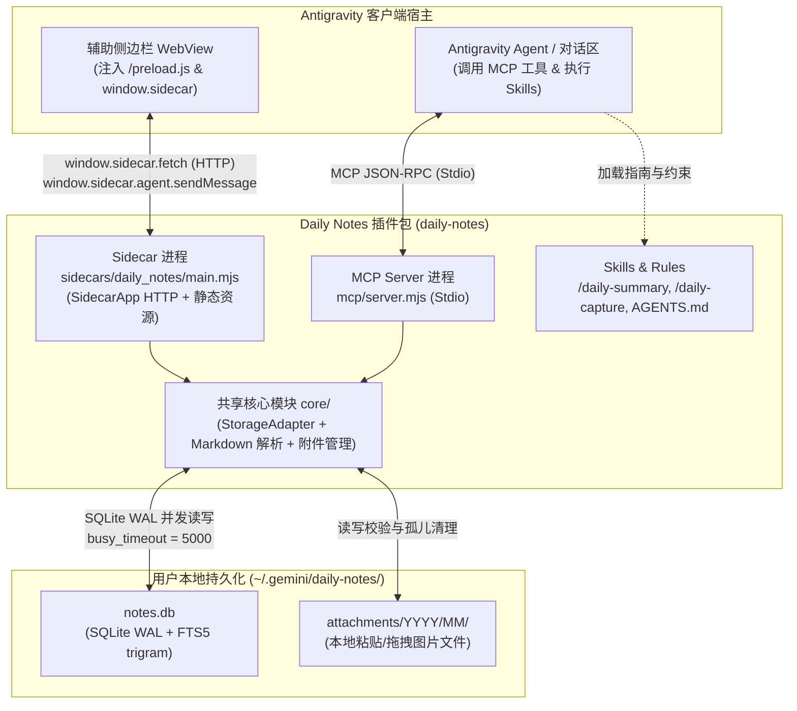

# Daily Notes（每日笔记）系统架构与接口设计

## 1. 架构总览

**Daily Notes（每日笔记）** 采用 **双端共享本地存储核心（Shared Core + SQLite WAL）** 架构：
- **Sidecar Web 服务与 UI**：由 Antigravity 宿主通过 `sidecar_sdk`（`SidecarApp`）拉起，服务编译后的静态 React + Tiptap 前端界面并提供本地 HTTP REST API，渲染在辅助侧边栏（`SIDECAR_UI_ENTRYPOINT_AUX_PANE`）。
- **Stdio MCP Server**：由 Antigravity Language Server 按需拉起，通过标准输入输出暴露 7 个笔记读写与检索工具，与 Sidecar 共享同一份 `core/` 存储引擎和本机 SQLite 数据库（`~/.gemini/daily-notes/notes.db`）。
- **Skills 与 Rules**：提供 `/daily-summary`、`/daily-capture` 标准化工作流及安全写作行为约束。



---

## 2. Antigravity 插件目录与清单规范

### 2.1 Monorepo 与插件目录结构
仓库采用 **pnpm monorepo** 组织，将共享存储核心（`packages/core`）、可独立安装的插件本体（`packages/plugin`）与 Astro 落地页（`apps/marketing`）解耦。为确保执行 `agy plugin install ./packages/plugin` 安装到本地 `~/.gemini/config/plugins/daily-notes/` 后即可**零额外依赖运行**，构建脚本将前端编译至 `packages/plugin/sidecars/daily_notes/dist/`，并通过 `esbuild` 将 `@daily-notes/core` 与运行时依赖内联打包进 `packages/plugin/sidecars/daily_notes/main.mjs` 和 `packages/plugin/mcp/server.mjs`：

```text
agy-plugin-dailynote/ (Monorepo 根目录)
├── pnpm-workspace.yaml
├── package.json
├── packages/
│   ├── core/                                 # @daily-notes/core（纯 Node 零外部依赖）
│   │   ├── package.json
│   │   ├── src/                              # config/db/storage-adapter/markdown/attachments/notes-service
│   │   └── tests/                            # core 单元与并发测试
│   └── plugin/                               # @daily-notes/plugin（可独立安装的插件根目录）
│       ├── plugin.json                       # 必填：插件主清单
│       ├── assets/logo.svg                   # 插件图标（>=128x128 透明背景方图）
│       ├── mcp_config.json                   # MCP Server 注册配置
│       ├── rules/AGENTS.md                   # 插件启用期间生效的 Agent 协同约束
│       ├── skills/                           # /daily-summary 与 /daily-capture 技能
│       ├── sidecars/daily_notes/
│       │   ├── sidecar.json                  # 侧边栏 UI Sidecar 声明
│       │   ├── src/main.mjs                  # Sidecar 源码（导入 @daily-notes/core）
│       │   ├── main.mjs                      # 打包产物（内联 @daily-notes/core）
│       │   └── dist/                         # Vite 构建的前端经典 IIFE 静态产物
│       ├── mcp/
│       │   ├── src/server.mjs                # Stdio MCP 源码（导入 @daily-notes/core）
│       │   └── server.mjs                    # 打包产物（内联 @daily-notes/core 与 SDK）
│       ├── web/                              # React + TypeScript + Vite + Tiptap 前端源码
│       ├── scripts/                          # 构建脚本（build-all / build-sidecar / build-mcp）
│       └── tests/                            # 清单、Sidecar HTTP、MCP 与前端编解码测试
├── apps/
│   └── marketing/                            # @daily-notes/marketing（Astro 静态落地页）
└── docs/                                     # 需求与架构设计文档
```

> [!NOTE]
> V1 不包含生命周期拦截需求，因此不创建 `hooks.json`；若后续版本需要扩展 Hook，须按 Antigravity 原生插件规范直接放在插件根目录（`hooks.json`）。

### 2.2 `plugin.json`
严格遵循 Antigravity `plugin.json` 合法顶层字段（禁止放置未定义顶层字段，否则加载器会静默丢弃）：

```json
{
  "$schema": "https://antigravity.google/schemas/v1/plugin.json",
  "name": "daily-notes",
  "displayName": "Daily Notes",
  "version": "0.1.0",
  "description": "在 Antigravity 侧边栏提供所见即所得的每日笔记编辑体验，数据保存在本地 SQLite，并支持与 Agent 安全双向协同。",
  "logo": "assets/logo.svg",
  "suggestedPrompts": [
    "帮我总结今天的每日笔记和未完成待办",
    "把刚才讨论的结论和修改点记录到今天的笔记里",
    "汇总最近 7 天每日笔记中尚未完成的任务清单"
  ]
}
```

### 2.3 `sidecars/daily_notes/sidecar.json`
声明侧边栏 Web UI、后台保活策略与对话发送权限：

```json
{
  "command": "node",
  "args": ["main.mjs"],
  "env": {
    "DAILY_NOTES_DATA_DIR": "${env:DAILY_NOTES_DATA_DIR}"
  },
  "restart_policy": "always",
  "display_name": "每日笔记",
  "description": "所见即所得的侧边栏每日笔记，本地 SQLite 持久化并支持与 Agent 双向协同。",
  "has_web_ui": true,
  "agent_permissions": {
    "allows_user_interactions": true
  },
  "ui_config": {
    "display_name": "每日笔记",
    "views": [
      {
        "path": "/",
        "entrypoint": "SIDECAR_UI_ENTRYPOINT_AUX_PANE",
        "title": "每日笔记"
      }
    ]
  }
}
```

> **说明**：
> - `allows_user_interactions: true` 允许前端在用户主动点击「AI 总结今日」或「发送到对话」时调用 `window.sidecar.agent.sendMessage`。
> - 当 `DAILY_NOTES_DATA_DIR` 未设置或展开为空字符串时，后端自动回退到 `~/.gemini/daily-notes`。

### 2.4 `mcp_config.json`
使用 `${PLUGIN_ROOT}` 保证插件在全局或工作区安装目录下均可定位脚本：

```json
{
  "mcpServers": {
    "daily-notes": {
      "command": "node",
      "args": ["${PLUGIN_ROOT}/mcp/server.mjs"],
      "env": {
        "DAILY_NOTES_DATA_DIR": "${env:DAILY_NOTES_DATA_DIR}"
      }
    }
  }
}
```

---

## 3. 技术栈选型与运行时约束

### 3.1 前端技术栈（`web/`）
- **核心框架**：`React 19` + `TypeScript` + `Vite`（构建为自包含静态文件，不请求外部 CDN 字体/脚本，离线与暗黑模式零闪烁）。
- **WYSIWYG 编辑器内核**：**Tiptap v2（基于 ProseMirror）**
  - **选型理由**：在 Antigravity `320px–480px` 窄侧边栏场景下，Tiptap 对 `BubbleMenu` 浮层边界夹紧、`/` 斜杠指令插件、自定义原子节点（`[[YYYY-MM-DD]]` 日期双链）、表格滚动容器包裹以及受控 `editable`/焦点状态的控制力显著优于 Milkdown；且生态成熟、ProseMirror Transaction 模型易于处理外部刷新与防抖保存边界。
  - **关键扩展组合**：
    - 基础文档与排版：`StarterKit`（关闭内置 `CodeBlock`，改用 `CodeBlockLowlight`）、`Placeholder`、`Highlight`、`Link`
    - GFM 扩展块：`TaskList` + `TaskItem`、`Table` + `TableRow` + `TableHeader` + `TableCell`、`Image`
    - 交互浮层：`BubbleMenu`（选中格式与「发送到对话」）、自定义 `SlashCommand`（基于 `@tiptap/suggestion`）
    - 自定义扩展：`DateWikilink`（行内 Atom 节点，输入 `[[` 触发补全，点击触发日期跳转）+ `InlineTagDecoration`（ProseMirror Decoration 识别非代码区 `#tag` 并支持点击检索）
  - **Markdown 往返层**：封装专用 `markdown.mjs` / `serializer.ts`，基于规范 GFM（`remark` / `unified` 或 `tiptap-markdown` 定制扩展）保障「Tiptap 文档 ↔ Markdown 源码 ↔ SQLite `content_md`」三者双向往返无损。

### 3.2 后端与 SQLite 驱动策略（`core/` + `sidecars/` + `mcp/`）
- **Sidecar 框架**：直接通过 Antigravity 内置 loader 引入 `import { SidecarApp, Response } from 'sidecar_sdk'`（参考内置 `swarm_board` 模式）；同时兼容无 `sidecar_sdk` 时的独立 HTTP 启动模式方便脱离客户端开发调试。
- **SQLite 驱动（`StorageAdapter` 抽象）**：
  - 优先采用 Node.js 原生内置 **`node:sqlite`（`DatabaseSync`）**——已在当前宿主机 `Node v24.22.2` 与 `SQLite 3.54.0` 验证原生支持 `FTS5` 与 `trigram` 分词器，零原生 C++ 编译依赖、跨 macOS/Linux/Windows 架构迁移最稳健。
  - **运行时要求**：工作区要求 Node.js `>= 22.23.4`，与营销站 Astro 的最低版本一致。Sidecar 与 MCP 通过清单里的 `node` 命令启动，安装时需确认 Antigravity 能找到受支持的版本。
- **MCP SDK**：使用 `@modelcontextprotocol/sdk`（`McpServer` + `StdioServerTransport`），构建期通过 `esbuild` 将 `mcp/server.mjs` 及其依赖打包为独立可执行的单个 `.mjs` 文件（或随附精简运行时），避免用户安装插件后还要手动 `npm install`。

---

## 4. Sidecar HTTP REST API 契约

Sidecar 仅监听 `SidecarApp` 分配的本地环回端口。前端统一通过 `window.sidecar.fetch`（独立浏览器调试时回退原生 `fetch`）发起调用；所有 JSON 响应格式统一为 `{ ok: true, data }` 或 `{ ok: false, error: { code, message, details? } }`。

| 方法与路径 | 用途 | 请求参数 / Body | 关键响应字段 / 状态码 |
| :--- | :--- | :--- | :--- |
| `GET /api/health` | 健康检查与环境信息 | 无 | `{ status, data_dir, db_path, schema_version, mode }` |
| `GET /api/notes/:date` | 获取单日完整笔记 | `:date` 为 `YYYY-MM-DD` | `{ date, exists, content_md, revision, last_editor, updated_at, last_agent_at, tags, projects, backlinks, yesterday_pending }` |
| `GET /api/notes/:date/meta` | 轻量轮询版本元数据 | `:date` 为 `YYYY-MM-DD` | `{ date, exists, revision, updated_at, last_editor, last_agent_at, todo_total, todo_done }` |
| `PUT /api/notes/:date` | 保存/创建单日笔记 | `{ content_md, expected_revision, force? }` | `200` 返回更新后完整笔记；若 `expected_revision` 落后且未传 `force: true`，返回 `409 Conflict`（附最新服务端笔记） |
| `POST /api/notes/:date/carry-over` | 顺延昨日未完成待办或忽略提示 | `{ action: "apply" \| "dismiss", source_date? }` | `{ note, carried_count, skipped_count }` |
| `POST /api/notes/:date/projects` | 关联工作区项目 | `{ workspace_uri, workspace_name }` | `200` `{ projects }`（若当日尚无笔记行，惰性创建空笔记锚点或仅在保存时联动） |
| `DELETE /api/notes/:date/projects` | 取消关联项目 | `?workspace_uri=...` | `200` `{ projects }` |
| `GET /api/calendar` | 获取月度日历圆点聚合 | `?month=YYYY-MM&tag=&workspace_uri=` | `{ month, days: [{ date, has_note, todo_total, todo_done }] }` |
| `GET /api/search` | 全文、标签与项目检索 | `?q=&tag=&workspace_uri=&from=&to=&limit=30&offset=0` | `{ total, items: [{ date, snippet, tags, projects, updated_at }] }` |
| `GET /api/tags` | 标签列表与使用频次 | `?q=`（可选前缀过滤） | `{ tags: [{ tag, count }] }` |
| `GET /api/notes/:date/revisions` | 查询该日历史快照 | `?limit=50` | `{ revisions: [{ id, revision, source, summary, created_at, preview }] }` |
| `POST /api/notes/:date/revisions/:id/restore` | 恢复到指定历史快照 | `{ expected_revision }` | `200` 自动备份当前版本后恢复目标内容并返回最新笔记 |
| `POST /api/attachments` | 上传粘贴/拖拽图片 | `multipart/form-data`（`file`, `note_date`） | `201` `{ id, url: "/api/attachments/<id>", mime_type, byte_size, orig_name }` |
| `GET /api/attachments/:id` | 读取本地图片文件 | `:id` 为合法 UUID/NanoID | 二进制图片流 + `Content-Type` + `Cache-Control: private, max-age=86400` |
| `GET /api/notes/:date/export` | 单日 Markdown 导出 | `?format=md&frontmatter=0\|1` | `text/markdown; charset=utf-8` + `Content-Disposition: attachment; filename="YYYY-MM-DD.md"` |

---

## 5. MCP Server 工具契约与 Skills / Rules 设计

### 5.1 MCP Tools（Server Key：`daily-notes`）
工具设计遵循「最小权限 + 读写分离 + 乐观锁防护 + 自动快照」原则：

| 工具名 | 权限 | 输入参数（Zod Schema） | 行为与安全规则 |
| :--- | :---: | :--- | :--- |
| `daily_notes_get` | 读 | `{ date?: string }`（默认今日） | 返回 `exists, date, content_md, revision, tags, projects, todo_total, todo_done, updated_at` |
| `daily_notes_list_range` | 读 | `{ start_date, end_date, tag?, workspace_uri?, include_content?: boolean }` | 最多一次跨度 90 天；`include_content=false` 时仅返回摘要、字数与待办统计，节省上下文 Token |
| `daily_notes_search` | 读 | `{ query?, tag?, workspace_uri?, from?, to?, limit?: number }` | 复用核心检索逻辑（>=3 字符走 FTS5 `trigram`，1–2 字符走 `LIKE` 降级），返回匹配日期与上下文片段 |
| `daily_notes_get_open_todos` | 读 | `{ days?: number, start_date?, end_date?, workspace_uri? }` | 扫描最近 N 天（默认 7 天）未勾选 `- [ ]` 事项，返回所属日期、行号、任务文本 |
| `daily_notes_append` | 写 | `{ date?: string, markdown: string, heading?: string, workspace_uri?, workspace_name?, summary?: string }` | **安全首选写工具**：若指定 `heading` 存在则追加到该小节末尾，否则追加到文档末尾；写入前自动存档旧版本快照到 `note_revisions`（`source='agent'`），`last_editor='agent'`，递增 `revision` |
| `daily_notes_toggle_todo` | 写 | `{ date?: string, expected_revision: number, line_number?: number, match_text?: string, completed: boolean }` | **定点状态切换**：严格校验 `expected_revision`，仅修改匹配的任务行 `[ ]` ↔ `[x]`，写前自动存快照 |
| `daily_notes_update` | 写 | `{ date?: string, expected_revision: number, mode: "replace" \| "replace_section", heading?: string, markdown: string, summary: string }` | **受控覆盖更新**：强制要求先调用 `daily_notes_get` 获取 `expected_revision`；版本不一致返回结构化冲突错误，绝不强行覆盖；写前必存快照 |

### 5.2 内置 Skills 与 Rules
1. **`skills/daily-summary/SKILL.md`（`/daily-summary`）**：
   - 指导 Agent 调用 `daily_notes_get` / `daily_notes_list_range` / `daily_notes_get_open_todos`，根据用户提问生成当日工作总结、周报提炼或待办优先级整理；除非用户明确要求「写入/补充到笔记」，否则仅在对话中输出总结。
2. **`skills/daily-capture/SKILL.md`（`/daily-capture`）**：
   - 指导 Agent 从当前对话提炼简洁、结构化的纪要/排查结论/待办条目（附可选 `#标签` 与当前项目关联），优先使用 `daily_notes_append` 写入当日笔记，并在回复中明确告知「已写入 2026-11-25 笔记（版本号 rev N），如不满意可在侧边栏一键撤销」。
3. **`rules/AGENTS.md`**：
   - 当插件启用时注入轻量规则：
     - 修改或覆盖每日笔记前，必须先读取最新 `revision`；优先用 `daily_notes_append` 而非整篇覆写 `daily_notes_update`。
     - 严禁虚构不存在的历史笔记内容或擅自删除用户手动编写的段落；若发生 `REVISION_CONFLICT`，先向用户展示冲突内容并确认处理方式。

---

## 6. 跨进程并发写入与冲突解决时序

Sidecar 进程与 MCP Server 进程同时连接本机 `notes.db`。依托 SQLite **WAL 模式 + `BEGIN IMMEDIATE` 写事务 + 乐观锁版本号 `revision`**，保证任意时刻不会出现 SQLITE_BUSY 崩溃或静默覆盖：

```mermaid
sequenceDiagram
    participant UI as 侧边栏 UI (Tiptap)
    participant Sidecar as Sidecar HTTP API
    participant DB as SQLite WAL (notes.db)
    participant Mcp as MCP Server
    participant Agent as Antigravity Agent

    Note over UI,DB: 初始状态：2026-11-25 笔记处于 revision = 5，UI 为 Clean 状态
    Agent->>Mcp: 调用 daily_notes_append(date="2026-11-25", markdown="...")
    Mcp->>DB: BEGIN IMMEDIATE; 查询当前 revision=5
    Mcp->>DB: INSERT INTO note_revisions (保存 rev=5 原全文, source='agent')
    Mcp->>DB: UPDATE notes SET content_md=..., revision=6, last_editor='agent'; COMMIT
    Mcp-->>Agent: 返回成功 (new_revision=6, snapshot_id=42)

    loop 每 2 秒或窗口重新聚焦
        UI->>Sidecar: GET /api/notes/2026-11-25/meta
        Sidecar->>DB: SELECT revision, last_editor FROM notes
        DB-->>Sidecar: revision=6, last_editor='agent'
        Sidecar-->>UI: 返回新版本号 rev=6
    end

    alt UI 无未保存修改 (Clean)
        UI->>Sidecar: GET /api/notes/2026-11-25
        Sidecar-->>UI: 返回 rev=6 最新内容
        UI->>UI: 无缝更新编辑器并弹出「Agent 已更新 · 一键撤销」
    else UI 存在未保存用户输入 (Dirty)
        UI->>UI: 暂停自动保存，顶部弹出冲突解决条
        Note over UI: 用户可选择：保留我的覆盖 / 加载 Agent 版本 / 对比复制
    end
```

---

## 7. 安全与沙箱边界

1. **网络与通信隔离**：Sidecar HTTP 服务仅由 `sidecar_sdk` 绑定本地环回接口，不开放公网端口；写操作与上传接口校验宿主注入的请求鉴权机制（通过 `window.sidecar.fetch`）。
2. **文件与路径穿越防护**：
   - 所有附件 ID 严格限制为 URL 安全的 `[a-zA-Z0-9_-]{12,64}`；读取本地图片时使用 `path.resolve` + 前缀严格校验，保证文件绝对路径必须位于 `${DAILY_NOTES_DATA_DIR}/attachments/` 内。
   - 图片上传强制校验扩展名与文件魔数（Magic Bytes）白名单：`image/png`、`image/jpeg`、`image/webp`、`image/gif`（V1 禁止直接上传渲染 `image/svg+xml` 以防内嵌脚本 XSS），单文件大小上限 `10 MB`。
3. **XSS 与 HTML 注入防护**：
   - 正文持久化与交换统一以 **Markdown** 为唯一事实源；前端禁止直接把原始未清洗 HTML 字符串注入 DOM，所有富文本节点均经由 Tiptap Schema 白名单解析生成；外链仅允许 `http://`、`https://`、`mailto:` 与插件内部 `sidecar://`（或内部日期路由），过滤 `javascript:` 等危险协议。
4. **Agent 写入可控性**：MCP Server 不提供批量删除笔记、清空数据库或直接执行任意 SQL 的工具；所有 AI 改写强制经过快照备份，确保用户的手写资产随时可恢复。

---

## 8. 本地开发与验证工作流

1. **前端独立与联合开发**：
   - `npm run dev:web` 启动 Vite 热更新开发服务器，通过代理连接本地独立运行的 Sidecar（`DAILY_NOTES_DATA_DIR=/tmp/dn-dev node sidecars/daily_notes/main.mjs`）。
   - `npm run build` 将前端打包至 `sidecars/daily_notes/dist/`，并对核心模块与 MCP Server 执行打包检查。
2. **插件格式校验与客户端安装测试**：
   ```bash
   agy plugin validate --strict .
   agy plugin install .
   agy plugin list
   ```
3. **自动化测试矩阵**：
   - 单元测试：`core/` SQLite 事务、乐观锁 `409` 冲突、FTS5 中文（1–2 字与 3+ 字）检索、Markdown 与 `#tag`/`[[date]]` 提取、待办顺延幂等性、图片孤儿清理。
   - 端到端集成测试：模拟 Sidecar 与 MCP 双进程并发写入 WAL 数据库，验证快照回滚完整恢复数据。
